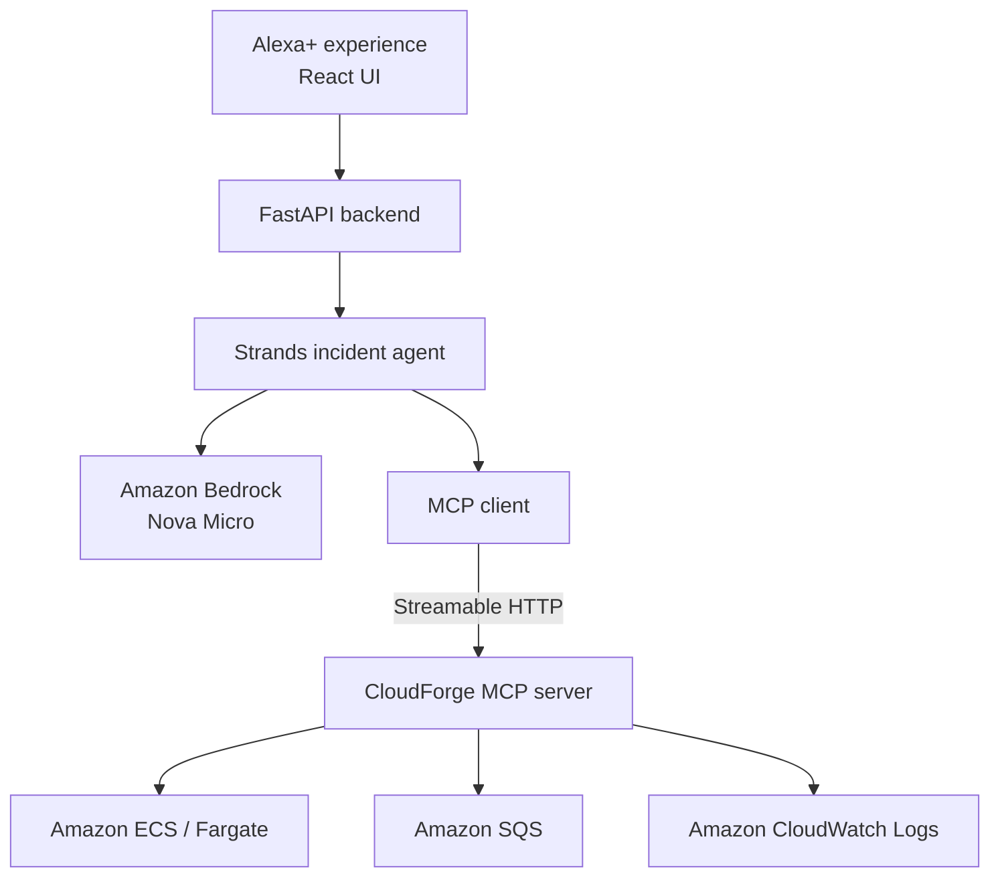

# CloudForge

CloudForge is an Alexa+ MCP incident investigator for a deliberately broken AWS
orders pipeline. A user asks, **“Why are orders delayed?”** and one Strands agent
collects live evidence from Amazon ECS, Amazon SQS, and Amazon CloudWatch before
explaining the likely cause and recommending a safe next step.

CloudForge is built for the **Alexa+ primary track** and the **AWS Builder mini
challenge** of the [Amazon App Dev Challenge](https://amazonappdev2026.devpost.com/rules).
It is a self-hosted MCP server with a focused web interface for demonstrating
the Alexa+ experience.

| Submission detail | CloudForge |
| --- | --- |
| Primary track | Alexa+ |
| Mini challenge | AWS Builder |
| MCP transport | Streamable HTTP at `/mcp` |
| MCP protocol | `2025-11-25` or later through `mcp>=2.3` |
| Source | [Public GitHub repository](https://github.com/ArjunKaliyath/cloudforge) |
| License | [MIT](LICENSE) |

## The problem

When orders stop moving, an engineer may have to inspect compute capacity, queue
depth, and logs in separate AWS consoles. CloudForge turns that investigation
into one bounded natural-language workflow:

1. inspect the ECS orders-worker service;
2. measure the SQS order backlog;
3. search CloudWatch for the simulated `Database connection failed` signature;
4. correlate the evidence into a concise diagnosis; and
5. recommend remediation without changing infrastructure.

The demo uses real AWS state. `BROKEN_MODE=true` makes the worker log a database
failure and leave messages unacknowledged. No database is created or contacted.

## Architecture



The Strands agent has no direct AWS client. All infrastructure evidence crosses
the MCP boundary through three read-only, typed tools:

| MCP tool | Evidence returned |
| --- | --- |
| `get_service_health` | ECS service status and desired, running, and pending task counts |
| `get_queue_status` | Approximate available, in-flight, delayed, and total SQS messages |
| `search_logs` | A bounded CloudWatch exact-phrase search over a bounded time window |

The server exposes no arbitrary boto3 operation, shell access, or remediation
tool. Tool inputs and outputs are validated, and the agent is limited to five
model turns and 2,400 output tokens per investigation.

## How it meets the Alexa+ track

- [`mcp_server.py`](mcp_server.py) runs a real self-hosted MCP server over
  Streamable HTTP.
- The server uses the current MCP Python SDK and negotiates protocol version
  `2025-11-25` or later.
- [`incident_agent.py`](incident_agent.py) imports and calls the Strands Agents
  SDK at runtime, connects through the MCP client, and invokes Amazon Nova Micro
  through Bedrock.
- [`diagnostics.py`](diagnostics.py) is the only AWS operations layer used by the
  MCP tools.
- [`web/`](web/) and [`api.py`](api.py) provide the optional web simulation used
  in the demonstration.
- The complete source is public under the MIT license.

## AWS services

| Service | Role in the working product |
| --- | --- |
| Amazon ECS on AWS Fargate | Runs the containerized orders worker in healthy or broken mode |
| Amazon ECR | Stores the worker image used by Fargate |
| Amazon SQS | Holds sample orders and exposes the real backlog signal |
| Amazon CloudWatch Logs | Stores successful processing and failure evidence |
| Amazon Bedrock | Runs Amazon Nova Micro for the investigation and diagnosis |

ECR is supporting deployment infrastructure. The agent investigates only ECS,
SQS, and CloudWatch through MCP.

## Run the project

### Prerequisites

- Python 3.12 or later
- [uv](https://docs.astral.sh/uv/)
- Node.js and npm
- AWS CLI v2
- Docker Desktop for deploying the worker
- an AWS profile with access to the resources above and Amazon Nova Micro in
  `us-east-1`

No AWS credentials are stored in the repository. The examples use PowerShell
and a placeholder profile name.

### 1. Clone and build the UI

```powershell
git clone https://github.com/ArjunKaliyath/cloudforge.git
Set-Location cloudforge

Set-Location web
npm ci
npm run build
Set-Location ..
```

### 2. Prepare the demo incident

Set your local AWS profile and sign in:

```powershell
$profile = "<your-aws-profile>"
$region = "us-east-1"
aws login --profile $profile
aws sts get-caller-identity --profile $profile
```

An administrator must first review and attach the scoped example policies in
[`infra/deployer-iam-policy.json`](infra/deployer-iam-policy.json) and
[`infra/bedrock-agent-iam-policy.json`](infra/bedrock-agent-iam-policy.json).
Replace `ACCOUNT_ID` in the deployment policy with the target AWS account ID.

Create the queue, build the worker, and deploy broken mode:

```powershell
uv run --locked orders.py --profile $profile --region $region create
docker build -t cloudforge-orders-worker:local .
& .\infra\deploy-ecs.ps1 -Profile $profile -Region $region -BrokenMode:$true
uv run --locked orders.py --profile $profile --region $region seed --count 5
```

Wait for the worker to receive the messages. It will log the simulated failure
and leave the messages in SQS. Approximate queue counts may take a short time to
settle after the 30-second visibility timeout.

### 3. Start the MCP server

In the first PowerShell terminal:

```powershell
$env:AWS_PROFILE = "<your-aws-profile>"
$env:AWS_DEFAULT_REGION = "us-east-1"
uv run --isolated --locked --extra mcp-server mcp_server.py
```

The MCP endpoint is `http://127.0.0.1:8000/mcp`.

### 4. Start the application

In a second PowerShell terminal:

```powershell
$env:AWS_PROFILE = "<your-aws-profile>"
$env:AWS_DEFAULT_REGION = "us-east-1"
uv run --isolated --locked --extra agent `
  uvicorn api:app --host 127.0.0.1 --port 8001
```

Open `http://127.0.0.1:8001`, keep **Why are orders delayed?** in the input, and
select **Investigate**. The completed response shows the diagnosis, MCP tools
used, model turns, token usage, and stop reason.

The MCP server and Strands currently require incompatible MCP SDK ranges. The
two `uv run --isolated` commands intentionally give each process its locked,
compatible environment.

### 5. Stop chargeable compute

Stop both local processes with `Ctrl+C`, then scale the Fargate service to zero:

```powershell
aws ecs update-service `
  --cluster cloudforge `
  --service orders-worker `
  --desired-count 0 `
  --profile $profile `
  --region $region
```

This stops Fargate compute. ECR image storage, CloudWatch logs, SQS usage, and
Bedrock requests can still use credits or incur charges.

## Test without an AWS account

The automated tests use fake AWS clients and an in-memory MCP client. They do
not contact AWS or invoke Bedrock.

```powershell
uv run --isolated --locked --extra mcp-server `
  python -m unittest tests/test_orders.py tests/test_diagnostics.py tests/test_mcp_server.py -v

uv run --isolated --locked --extra agent `
  python -m unittest tests/test_incident_agent.py tests/test_api.py -v

Set-Location web
npm ci
npm run build
Set-Location ..
```

## Demonstration

The repeatable [demo script](docs/DEMO_SCRIPT.md) fits the required sub-three-
minute video and covers:

1. the customer-impact question;
2. the read-only MCP safety boundary;
3. one live investigation;
4. ECS, SQS, and CloudWatch evidence;
5. the agent's diagnosis and recommendation; and
6. the final cost-safe ECS state.

## Product feedback

### Tools and why they were used

| Tool, API, or SDK | Why CloudForge uses it | What worked well | What could improve |
| --- | --- | --- | --- |
| MCP Python SDK | Publish typed AWS diagnostic tools over Streamable HTTP | Typed schemas, structured results, and read-only annotations made the boundary easy to inspect | Compatibility with the MCP version required by Strands forced separate uv environments |
| Strands Agents SDK | Orchestrate the bounded investigation and report actual tool metrics | MCP integration, tool filtering, and per-run metrics made agent behavior visible | A simpler compatibility path to the latest MCP Python SDK would reduce setup friction |
| Amazon Bedrock Converse integration | Run Nova Micro without managing model infrastructure | Nova Micro completed the narrow investigation quickly and economically | Model access, discovery permissions, and regional configuration require careful IAM setup |
| AWS SDK for Python (boto3) | Read ECS, SQS, and CloudWatch state behind the MCP server | Mature clients and injectable dependencies supported both live checks and offline tests | Browser-login credentials additionally required the CRT package, which was not obvious initially |
| ECS/Fargate and ECR | Run and store the real orders-worker container | Task roles, service state, and native logging produced credible runtime evidence | First-time IAM, networking, and registry setup is substantial for a small demo |
| Amazon SQS | Create a visible and measurable order backlog | Visibility timeout and approximate counts model a realistic asynchronous incident | Eventual consistency can confuse a first-time user immediately after a receive attempt |
| Amazon CloudWatch Logs | Preserve the worker's failure evidence | The `awslogs` integration made container logs available without application-side shipping code | Query timing and repeated SQS delivery require explanation in a short demo |

### Onboarding and future use

The local Python and React setup was straightforward with uv and npm. The most
time-consuming onboarding work was configuring least-privilege IAM, learning
the difference between an AWS IAM identity and a local AWS profile, and resolving
the SDK compatibility split. The AWS and Strands documentation was sufficient
once the required permissions and versions were known.

I would build with this stack again for a scoped operational assistant. MCP gives
the agent a narrow and auditable capability surface, Strands keeps orchestration
small, and AWS supplies real operational signals. For a production version, I
would first add authentication, deployment automation, and evaluation coverage;
those features are deliberately outside this hackathon MVP.

Detailed, reproducible setup issues and suggested improvements are recorded in
the [development friction log](friction-log.md).

## Repository guide

| Path | Purpose |
| --- | --- |
| [`orders.py`](orders.py) | SQS seed/status CLI and healthy/broken worker |
| [`diagnostics.py`](diagnostics.py) | Read-only AWS diagnostic operations |
| [`mcp_server.py`](mcp_server.py) | Typed Streamable HTTP MCP server |
| [`incident_agent.py`](incident_agent.py) | Strands + Bedrock investigation agent |
| [`api.py`](api.py) | FastAPI boundary and built React app hosting |
| [`web/`](web/) | React + TypeScript demonstration UI |
| [`infra/`](infra/) | ECS deployment script and scoped IAM examples |
| [`tests/`](tests/) | Offline unit and integration-style tests |
| [`docs/MVP_Plan.md`](docs/MVP_Plan.md) | MVP scope and acceptance criteria |
| [`docs/DEMO_SCRIPT.md`](docs/DEMO_SCRIPT.md) | Recording and preflight guide |
| [`friction-log.md`](friction-log.md) | Development issues, workarounds, and feedback |

## License

CloudForge is released under the [MIT License](LICENSE).
